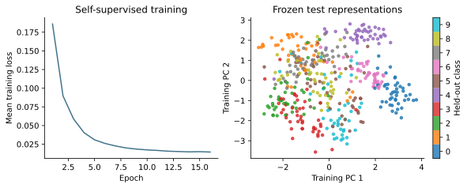

# I-JEPA

An 8×8 digit is divided into sixteen 2×2 patches. A transformer predicts two held-out spatial blocks in the embedding space of a full-image target encoder.

[Executed notebook](i_jepa.ipynb) · [Python script](i_jepa.py)

## Tokenise the input

Tokens keep a fixed spatial order. Context and target positions are selected after tokenisation.

## Predict hidden features

A full-view, stop-gradient target encoder supplies the targets. The online encoder sees visible tokens only. A separate predictor combines the context with learned mask tokens and positional embeddings.

## Probe a frozen encoder

A logistic probe is trained on the labelled training partition after self-supervision. The raw and random-feature baselines see the same examples.

## Recorded output

```text
Held-out masked latent MAE: 0.1208
Raw input: accuracy 0.969 | balanced accuracy 0.969 | macro F1 0.969
Random encoder: accuracy 0.980 | balanced accuracy 0.980 | macro F1 0.980
Trained encoder: accuracy 0.980 | balanced accuracy 0.980 | macro F1 0.980
Held-out mean feature SD: 0.1460 | Effective covariance rank: 19.19
```

## Reading the result

This CPU-scale adaptation uses one transformer layer and two disjoint block masks. The paper studies much larger inputs and training sets. Its benchmark results are a separate experiment.



## References

[Assran et al., Self-Supervised Learning from Images with a Joint-Embedding Predictive Architecture (2023)](https://arxiv.org/abs/2301.08243)

[Alpaydin and Kaynak, Optical Recognition of Handwritten Digits, UCI, CC BY 4.0](https://doi.org/10.24432/C50P49)

[Frozen probes and masked-prediction training](../gallery/representations.py)
