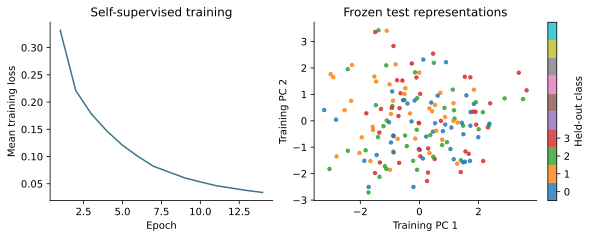

# V-JEPA

A moving disk is divided into non-overlapping 2-frame tubelets of 4×4 pixels. The target is a contextual feature vector for each hidden tubelet.

[Executed notebook](v_jepa.ipynb) · [Python script](v_jepa.py)

## Tokenise the input

Tokens keep a fixed spatial order. Context and target positions are selected after tokenisation.

## Predict hidden features

A full-view, stop-gradient target encoder supplies the targets. The online encoder sees visible tokens only. A separate predictor combines the context with learned mask tokens and positional embeddings.

## Probe a frozen encoder

A logistic probe is trained on the labelled training partition after self-supervision. The raw and random-feature baselines see the same examples.

## Recorded output

```text
Held-out masked latent MAE: 0.1960
Raw input: accuracy 0.362 | balanced accuracy 0.362 | macro F1 0.359
Random encoder: accuracy 0.300 | balanced accuracy 0.300 | macro F1 0.299
Trained encoder: accuracy 0.338 | balanced accuracy 0.337 | macro F1 0.335
Held-out mean feature SD: 0.1713 | Effective covariance rank: 100.59
```

## Reading the result

This CPU-scale adaptation uses one transformer layer and two disjoint block masks. The paper studies much larger inputs and training sets. Its benchmark results are a separate experiment.



## References

[Bardes et al., Revisiting Feature Prediction for Learning Visual Representations from Video (2024)](https://arxiv.org/abs/2404.08471)

[Frozen probes and masked-prediction training](../gallery/representations.py)
