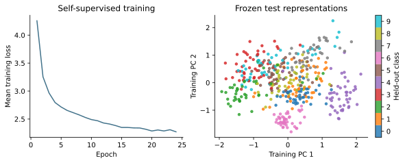

# SimCLR

Two independently corrupted versions of the same digit form a positive pair. Embeddings from other digits in the batch supply negatives without consulting their labels.

[Executed notebook](simclr.ipynb) · [Python script](simclr.py)

## Two views and a contrastive loss

The denominator contains every embedding except the anchor itself. The target points to the other view of the same image.

## Contrastive training

The projection head participates in the contrastive loss. The downstream probe uses the encoder output before that head.

## Downstream comparison

All three linear probes share the same train and test split.

## Recorded output

```text
Raw input: accuracy 0.969 | balanced accuracy 0.969 | macro F1 0.969
Random encoder: accuracy 0.951 | balanced accuracy 0.951 | macro F1 0.951
Trained encoder: accuracy 0.947 | balanced accuracy 0.946 | macro F1 0.947
Held-out mean feature SD: 0.2556 | Effective covariance rank: 7.67
```

## Reading the result

The loss rewards instance agreement. Class information is checked separately by the frozen digit probe.



## References

[Chen et al., A Simple Framework for Contrastive Learning of Visual Representations (2020)](https://proceedings.mlr.press/v119/chen20j.html)

[Alpaydin and Kaynak, Optical Recognition of Handwritten Digits, UCI, CC BY 4.0](https://doi.org/10.24432/C50P49)

[Frozen probes and masked-prediction training](../gallery/representations.py)
