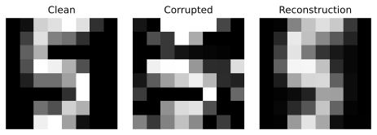
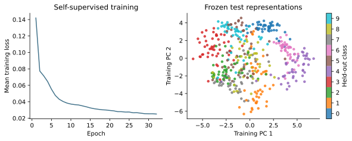

# Denoising Autoencoder

An encoder maps a corrupted digit to sixteen numbers. Its decoder reconstructs clean pixel intensities from that bottleneck.

[Executed notebook](denoising_autoencoder.ipynb) · [Python script](denoising_autoencoder.py)

## Bottleneck

A narrow latent vector limits how much information can pass directly to the decoder.

## Remove noise

Only the training images provide reconstruction targets. A fixed independent noise draw is used to score held-out images.

## Frozen features

The probe and the reconstruction score measure different uses of the same latent vector.

## Recorded output

```text
Held-out noisy MSE 0.0461 | Reconstructed MSE 0.0256 | PSNR 15.93 dB
Raw input: accuracy 0.969 | balanced accuracy 0.969 | macro F1 0.969
Random encoder: accuracy 0.880 | balanced accuracy 0.879 | macro F1 0.878
Trained encoder: accuracy 0.916 | balanced accuracy 0.915 | macro F1 0.914
Held-out mean feature SD: 1.3670 | Effective covariance rank: 6.91
```

## Reading the result

PSNR here uses a peak intensity of one. A smooth reconstruction may score well in mean squared error while blurring some strokes.





## References

[Vincent et al., Extracting and Composing Robust Features with Denoising Autoencoders (2008)](https://doi.org/10.1145/1390156.1390294)

[Alpaydin and Kaynak, Optical Recognition of Handwritten Digits, UCI, CC BY 4.0](https://doi.org/10.24432/C50P49)

[Frozen probes and masked-prediction training](../gallery/representations.py)
