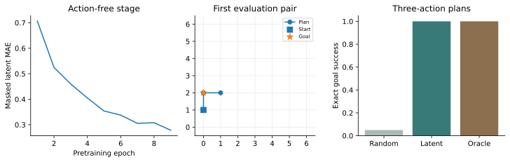

# V-JEPA 2 action-conditioned planning

Can a visual goal guide a short plan after a video encoder learns without actions? Pretrain on unlabelled clips, freeze the encoder and fit an action-conditioned model of motion on a small grid.

This CPU exercise follows the two-stage idea in V-JEPA 2-AC. Four rendered frames form two temporal tubelets. A small MLP learns single-step latent dynamics and an exhaustive three-action search selects a plan. All weights are trained here. The published system uses large video backbones, robot trajectories and a different search procedure.

[Worked notebook](v_jepa_2_action_conditioned_planning.ipynb) · [Python script](v_jepa_2_action_conditioned_planning.py)

## Pretrain the visual features without actions

The online encoder sees visible tubelets, while its moving-average target sees the complete clip. Only hidden target features enter the objective.

## Fit a frozen-space transition model

Each distinct position-action pair belongs to exactly one split. A PCA basis fitted to training-state encodings keeps the action model small. At planning time a still observation is presented as four copies of one frame.

## Plan towards held-out start-goal pairs

Draw distinct nontrivial pairs that can be connected in exactly three moves. The learned planner scores candidates only by predicted latent distance to the observed goal. The simulator supplies the evaluation and a reachable-goal reference.

## Results from the recorded run

| Transition model | Unseen state-action pairs | Latent MAE | Nearest-state accuracy |
| --- | --- | --- | --- |
| Keep current feature | 36 | 0.48970 | 0.16667 |
| Action-conditioned | 36 | 0.15189 | 1.00000 |

| Planner | Goal pairs | Exact goal success | Mean final Manhattan distance |
| --- | --- | --- | --- |
| Random 3-step plan | 80 | 0.05 | 2.2375 |
| Latent planner | 80 | 1.00 | 0.0000 |
| Simulator oracle | 80 | 1.00 | 0.0000 |

## Interpreting the result

On the 36 withheld state-action pairs, the learned transition cut latent MAE from 0.490 for persistence to 0.152. The three-move planner reached all 80 goals on this board. Four of the 80 random plans happened to reach theirs.

Transition prediction and planning have different denominators. The first table withholds individual actions from dynamics training. Planning evaluates ordered start-goal pairs on the same board, using an environment whose states are familiar.

## Exercise

Extend the horizon to four moves. Compare the growth in candidate count with any change in exact goal success.

## References

[Assran et al. (2025), V-JEPA 2](https://arxiv.org/abs/2506.09985)

[Bardes et al. (2024), Revisiting Feature Prediction for Learning Visual Representations from Video](https://arxiv.org/abs/2404.08471)
