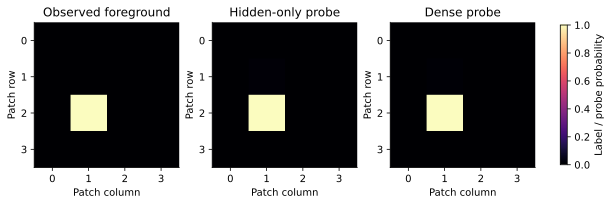

# V-JEPA 2.1 dense video features

What changes when a masked video model also learns at visible locations? Train two encoders from identical initial weights and assess their local features with a frozen foreground probe.

This small ablation compares hidden-only final-layer supervision with two components of V-JEPA 2.1 together: a distance-weighted context loss and prediction at two encoder depths. The scene is a moving point on a grid. The experiment does not separate the individual contributions of the two components.

[Worked notebook](v_jepa_2_1_dense_video_features.ipynb) · [Python script](v_jepa_2_1_dense_video_features.py)

## Train with matched video samples and masks

The target sees all tubelets. Only visible tubelets enter the student. In the dense variant, the context weight increases over four epochs and is largest next to the mask.

## Fit a foreground probe

A tubelet is positive if it contains a pixel near the centre of the rendered point in either frame. The fixed threshold is applied to the original intensities. The logistic probe trains on a separate set of clips, with an independent set for testing.

## Recorded output

```text
Test foreground prevalence: 0.081
```

## Results from the recorded run

| Frozen features | Test clips | Positive tubelets | Average precision | Foreground F1 | Balanced accuracy |
| --- | --- | --- | --- | --- | --- |
| Hidden-only | 120 | 312 | 0.98987 | 0.95122 | 0.99546 |
| Dense and two levels | 120 | 312 | 0.99727 | 0.96445 | 0.99674 |

## Interpreting the result

Of 3,840 held-out tubelets, 312 contained the centre of the moving point. Average precision was 0.990 for the hidden-only model and 0.997 for the dense, two-level model. Both encoders solved most of this simple foreground task.

Read average precision alongside foreground prevalence. The score depends on how well tubelets are ranked, while F1 also depends on the threshold. The first test clip supplies the visual example.



## Exercise

Train a third variant with context supervision at the last layer only. That extra comparison isolates the effect of the second prediction depth.

## References

[Mur-Labadia et al. (2026), V-JEPA 2.1](https://arxiv.org/abs/2603.14482)

[Assran et al. (2025), V-JEPA 2](https://arxiv.org/abs/2506.09985)
