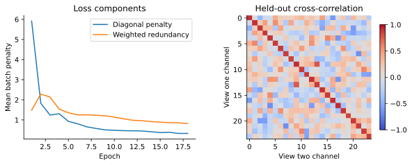

# Barlow Twins

Can two views of a digit agree without all feature coordinates learning the same thing? Barlow Twins sets a separate target for the diagonal and off-diagonal entries of a cross-correlation matrix.

The encoder and projection head share weights across the two views. The loss drives diagonal correlations towards one and the other correlations towards zero. Digit labels enter only after the encoder has been frozen.

[Worked notebook](barlow_twins.ipynb) · [Python script](barlow_twins.py)

## Optimise cross-view agreement

Translations of at most one pixel and independent additive noise generate the two views. Small final batches are skipped to keep the correlation estimate usable.

## Probe and inspect the cross-correlation

Fit a logistic probe on training features only. A separate pair of test views supplies the correlation heat map.

## Results from the recorded run

| Features | Test accuracy | Balanced accuracy | Macro F1 | Effective rank |
| --- | --- | --- | --- | --- |
| Raw pixels | 0.97111 | 0.97084 | 0.97099 | 20.17443 |
| Random encoder | 0.96667 | 0.96650 | 0.96657 | 10.29035 |
| Trained encoder | 0.95556 | 0.95477 | 0.95476 | 4.83248 |

| Test views | Mean diagonal | Off-diagonal RMS |
| --- | --- | --- |
| 450 | 0.88828 | 0.26146 |

## Interpreting the result

The test cross-correlation had a mean diagonal of 0.888 and an off-diagonal RMS of 0.261. The trained-feature probe classified 95.6% of test digits correctly, compared with 96.7% for the frozen random encoder.

The probe uses the 32 encoder features and the correlation plot uses the 24 projection features. They answer different questions about the same training run.

## Exercise

Increase the coefficient on off-diagonal terms and compare the probe result with the new cross-correlation matrix.

## References

[Zbontar et al. (2021), Barlow Twins](https://arxiv.org/abs/2103.03230)

[Alpaydin and Kaynak (1998), Optical Recognition of Handwritten Digits, UCI, CC BY 4.0](https://doi.org/10.24432/C50P49)
