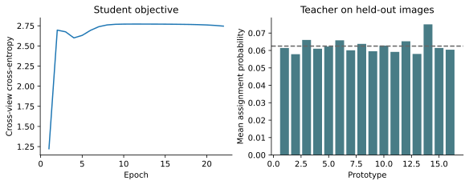

# DINO self-distillation

A student sees one view of a digit and predicts a distribution produced by a slowly moving teacher on another view.

The teacher uses a running centre and a lower softmax temperature. Its weights track the student by exponential moving average. This two-view convolutional exercise studies DINO's self-distillation objective with a small encoder.

[Worked notebook](dino_self_distillation.ipynb) · [Python script](dino_self_distillation.py)

## Train across independently augmented views

Each teacher output supervises the other student view. Centre updates use uncentred teacher logits after computing the current loss.

## Measure representation and prototype use

Class labels fit the linear probe. The entropy diagnostics use no labels and distinguish uncertain predictions from a prototype shared by every image.

## Results from the recorded run

| Features | Test accuracy | Balanced accuracy | Macro F1 | Effective rank |
| --- | --- | --- | --- | --- |
| Raw pixels | 0.97111 | 0.97084 | 0.97099 | 20.17443 |
| Random encoder | 0.96667 | 0.96650 | 0.96657 | 10.29035 |
| Trained encoder | 0.94000 | 0.93962 | 0.93982 | 1.82608 |

| Mean sample entropy (nats) | Marginal entropy (nats) | Effective prototypes | Uniform entropy |
| --- | --- | --- | --- |
| 2.72411 | 2.77054 | 15.96722 | 2.77259 |

## Interpreting the result

The teacher used almost all 16 prototypes in aggregate, yet its mean per-image entropy was 2.724 nats, close to the uniform value of 2.773. Its individual predictions were diffuse. The trained backbone also had lower effective rank and probe accuracy than its frozen random baseline.

The frozen probe measures class information in the backbone before the projection head.

## Exercise

Increase the teacher temperature towards the student temperature, then inspect the sample and marginal entropies together.

## References

[Caron et al. (2021), Emerging Properties in Self-Supervised Vision Transformers](https://arxiv.org/abs/2104.14294)

[Alpaydin and Kaynak (1998), Optical Recognition of Handwritten Digits, UCI, CC BY 4.0](https://doi.org/10.24432/C50P49)
