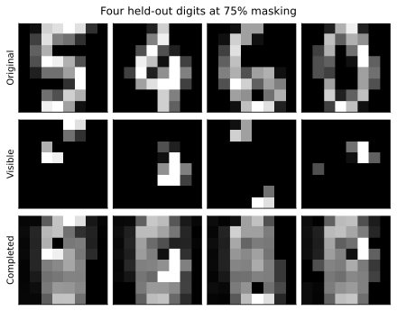

# Masked autoencoding

Show an encoder four of sixteen image patches and ask a lightweight decoder to recover the twelve missing patches. Here the target is the original pixel intensity.

The encoder receives only visible tokens. The decoder restores the sequence to spatial order with position-coded mask tokens. Mean squared error is measured on hidden patches. Digit labels are reserved for a frozen-feature probe.

[Worked notebook](masked_autoencoding.ipynb) · [Python script](masked_autoencoding.py)

## Train on hidden pixels

Every training image receives a new mask on each presentation. The decoder knows positions but receives pixel embeddings only at the four visible sites.

## Compare against the training-set mean patch

At evaluation each example has one fixed random mask. A position-specific average from the training images gives a reconstruction baseline.

## Results from the recorded run

| Features | Test accuracy | Balanced accuracy | Macro F1 | Effective rank |
| --- | --- | --- | --- | --- |
| Raw pixels | 0.97111 | 0.97084 | 0.97099 | 20.17443 |
| Random encoder | 0.91111 | 0.91067 | 0.91038 | 5.02471 |
| Trained encoder | 0.92222 | 0.92169 | 0.92187 | 5.53740 |

| Reconstruction | Hidden-pixel MSE | Hidden-pixel MAE |
| --- | --- | --- |
| Training mean | 0.07492 | 0.19651 |
| Decoder | 0.07451 | 0.19993 |

## Interpreting the result

Hidden-pixel MSE fell from 0.07492 for the training mean to 0.07451 for the decoder, while MAE rose from 0.19651 to 0.19993. The two errors weight large deviations differently. The probe gained about one percentage point over the random encoder.

The finished images preserve the four observed patches. Hidden-pixel metrics prevent that copied information from artificially lowering the reconstruction error.

## Exercise

Train with eight visible patches and compare the reconstruction error and the frozen probe.

## References

[He et al. (2022), Masked Autoencoders Are Scalable Vision Learners](https://arxiv.org/abs/2111.06377)

[Alpaydin and Kaynak (1998), Optical Recognition of Handwritten Digits, UCI, CC BY 4.0](https://doi.org/10.24432/C50P49)
