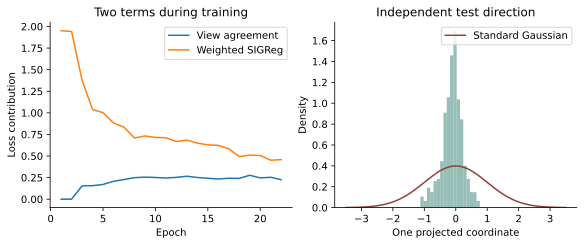

# LeJEPA and Gaussian projections

Two views of a digit should agree, yet different digits should occupy a spread of feature space. LeJEPA combines these goals by measuring how random one-dimensional projections compare with a standard Gaussian.

For each projection, the statistic compares the real and imaginary parts of the empirical characteristic function with exp(−t²/2). Gaussian-weighted trapezoidal integration and averaging over fresh directions give a differentiable regulariser. This version uses two global views and a compact convolutional encoder.

[Worked notebook](lejepa_and_gaussian_projections.ipynb) · [Python script](lejepa_and_gaussian_projections.py)

## Compare the views and regularise their distributions

The two embeddings learn towards their per-image mean. Draw sixteen unit directions per update and use the same directions to evaluate each view separately.

## Test the feature space

Use the same sample size and the same 64 fixed evaluation directions for the trained embeddings, a Gaussian reference and an all-zero feature cloud.

## Results from the recorded run

| Features | Test accuracy | Balanced accuracy | Macro F1 | Effective rank |
| --- | --- | --- | --- | --- |
| Raw pixels | 0.97111 | 0.97084 | 0.97099 | 20.17443 |
| Random encoder | 0.96667 | 0.96650 | 0.96657 | 10.29035 |
| Trained encoder | 0.75778 | 0.75553 | 0.75137 | 2.14755 |

| Projection input | Samples | Mean sliced statistic | Mean coordinate SD |
| --- | --- | --- | --- |
| Constant | 450 | 183.92015 | 0.00000 |
| Gaussian reference | 450 | 0.89028 | 0.98213 |
| Held-out digits | 450 | 96.08559 | 0.64904 |

## Interpreting the result

The held-out sliced statistic was 96.09, between the constant cloud at 183.92 and the finite Gaussian reference at 0.89. The probe reached 75.8%, below the random encoder at 96.7%. This short run leaves substantial room between the learned projection distribution and its target.

A histogram shows one direction, while the table averages discrepancies over 64. Finite samples from a Gaussian also have a positive statistic. The linear probe uses the encoder before the projection head.

## Exercise

Hold the augmentation and split fixed, set the regularisation weight to zero and track which diagnostics detect contraction.

## References

[Balestriero and LeCun (2025), LeJEPA](https://arxiv.org/abs/2511.08544)

[Alpaydin and Kaynak (1998), Optical Recognition of Handwritten Digits, UCI, CC BY 4.0](https://doi.org/10.24432/C50P49)
